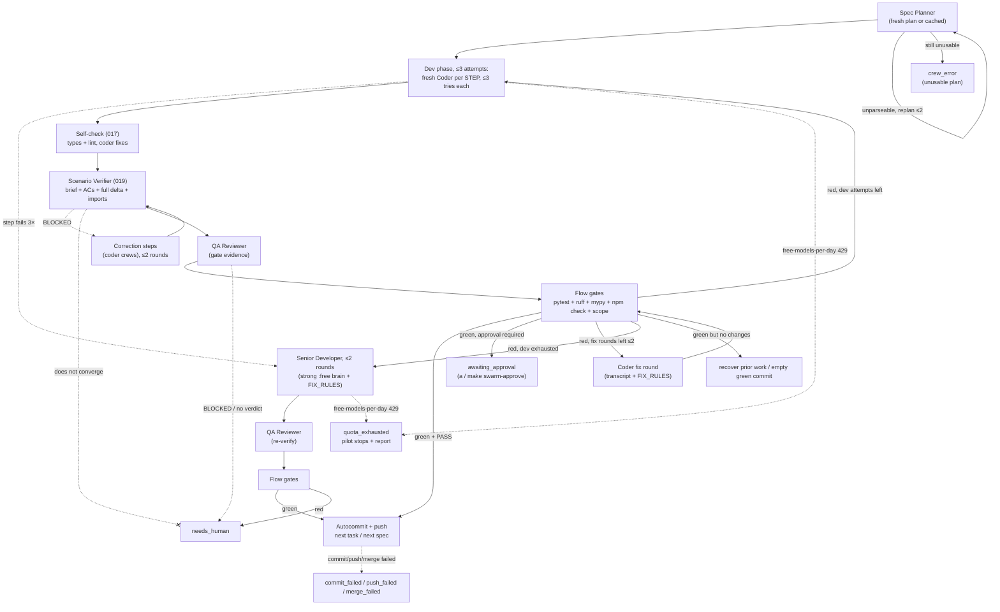

# Swarm harness — usage

Free-first CrewAI swarm that implements `specs/` tasks one at a time (`specs/009-swarm-harness/`, hardened by `specs/012-dark-factory-harness/`).
Roles: Planner + Coder + Reviewer, sequential; green runs autocommit and advance the queue.
Phase 0 of 012 is implemented: run-delta attribution, scope/secret guards, truthful green, plan hashing, commit/push coupling, single-run lock, approval holds, and AC evidence in `run.json`. Phase 1 has started with `make swarm-preflight` (T12).

## Prereqs
- `uv` installed; Python 3.12 available (`uv python list`). System Python 3.14 does NOT work with CrewAI (`>=3.10,<3.14`).
- Ollama serving locally: `ollama serve` + `ollama pull qwen3.5:9b` (default `OLLAMA_BASE_URL=http://localhost:11434`).
- Keys (never commit): root `.env` with `OPENROUTER_API_KEY` (planner/senior `:free` models);
  `OPENCODE_API_KEY` only if you route a role to `zen/*` (Zen's free tier is client-only, so the
  API path is paid — see the model table).

## Setup
```bash
uv venv -p 3.12 swarm/.venv
VIRTUAL_ENV="$PWD/swarm/.venv" uv pip install -p "$PWD/swarm/.venv/bin/python" -e 'swarm/[dev]'
cp .env.example .env   # optional overrides (keys stay empty until you fill them)
swarm/.venv/bin/python -c "from crewai import LLM,Agent,Task,Crew; print('ok')"
```

## Project-agnostic core
The harness does not hardcode a language or framework. Gate commands come from
`SWARM_GATE_COMMANDS` (semicolon/newline separated), scope from `SWARM_SCOPE`, and
the coder prompt is stack-inferred. Point those at another project and the same
flow works; only the guard *implementation* (`swarm/tools_guarded.py` path/secret
rules) is repo-specific.

## Model tiers (`swarm/llms.py` — the only file that picks models)
Verified 2026-11-08 (tool calls + latency): free unless noted.

| Role | Default | Cost |
| --- | --- | --- |
| Coder | `SWARM_CODER_MODEL=ollama/swarm-coder:latest` (Qwen3.5 9B, `make swarm-coder-image`) | $0 local, ~6–13 s |
| Planner | `SWARM_PLANNER_MODEL=openrouter/nvidia/nemotron-3.5-super-vl:free` | $0, 1M ctx, ~1 s |
| Reviewer | `SWARM_REVIEWER_MODEL=ollama/swarm-qa:latest` (Qwen3.5 9B, 64k ctx, QA prompt) | $0 local |
| Verifier | `SWARM_VERIFIER_MODEL`, default `SWARM_SENIOR_MODEL` (free, tool-capable) — the scenario verifier (019) | $0 |
| Verdict fallback | the senior model (`SWARM_SENIOR_MODEL`, free, tool-capable) — used only when local QA gives no verdict | $0 |
| Trivial-step coder | `SWARM_LOCAL_CODER_MODEL=ollama/swarm-coder:latest` (mechanical steps only; 015 D2) | $0 local |
| Senior | `SWARM_SENIOR_MODEL=openrouter/nvidia/nemotron-3-ultra-550b-a55b:free` | $0, 550B, tools OK |

All-local variant (no keys, slowest): `make swarm-local` sets every role to Ollama.
On a quota/429 the flow switches every subsequent crew to `SWARM_<ROLE>_FALLBACK_MODEL`
(default `SWARM_LOCAL_FALLBACK_MODEL=ollama/swarm-coder:latest`, one knob for every role; senior prefers cheap Zen when `SWARM_ALLOW_PAID=1`), then retries.

Free/cheap menu (re-checked live with a tool-call probe; ids churn, so run
`make swarm-preflight` before trusting them):
- OpenRouter `:free` tool-capable: `nvidia/nemotron-3.5-super-vl:free`,
  `nvidia/nemotron-3-ultra-550b-a55b:free`, `recursive/flint-v1.0:free`,
  `cohere/north-mini-code:free`, `nvidia/nemotron-3-nano-omni-30b-a3b-reasoning:free`.
  (`google/gemma-4-*:free` was upstream-429; `nvidia/nemotron-3.5-lightning:free` did not
  emit tool calls. The old planner id `nemotron-3-super-120b-a12b:free` is gone.)
- Ollama local: `swarm-coder`/`swarm-qa` (Qwen3.5 9B, 262k ctx), `qwen3.5:9b`,
  `qwen35-agent`, `llama3.2:1b` (tools work but emits malformed args — not a coder).
- Zen: **free models are client-only** (`FreeUsageLimitError` when called with an API key);
  paid models work from the API — `deepseek-v4.1-flash` (~$0.00002/call) and
  `glm-5.3-flash` are the cheapest. `gpt-5.4-nano` and `beam-free` are region-blocked (DE).

Paid models are hard-blocked: any non-`:free`/non-local/non-`-free` id raises `PermissionError`
unless `SWARM_ALLOW_PAID=1` in env. Override ids via env, never in code.

Model prefixes route automatically: `ollama/*` → local Ollama, `zen/*` → OpenCode Zen
(`custom_openai` gateway; `SWARM_ZEN_BASE_URL` must stop at `/v1` — the SDK appends
`/chat/completions`, a full URL gives 404).

## Preflight (before the first LLM call)
```bash
make swarm-preflight                              # roles/models, keys, Ollama pull, cloud lists, venvs, gates
swarm/.venv/bin/python -m swarm.preflight --offline   # skip provider model-list requests
```
`run_crew` runs the same checks automatically and stops with `preflight_failed` if any fail
(`SWARM_SKIP_PREFLIGHT=1` bypasses). This is 012 T12.

## Run
```bash
make swarm-run                 # foreground pilot (no args = resume; or ./swarm/run.sh 001 T1)
make swarm-local               # all-local pilot: Ollama Qwen for every role (overrides cloud .env)
make swarm-dash                 # dashboard attached to the current pilot
make swarm-up                   # pilot in background + dashboard attached
make swarm-up-local             # all-local pilot in background + dashboard attached
make swarm-test                 # harness unit tests (no LLM, no network)
make swarm-preflight            # validate models/keys/Ollama/venvs/gates (no LLM call)
make swarm-approve             # grant approval for the last checkpoint task (or SPEC=001 TASK=T3)
make swarm-approve SPEC=001 TASK=T3  # grant approval for a specific held task
make swarm-coder-image          # build tuned coder image (swarm/ollama/Modelfile → swarm-coder:latest)
```

Coder image: `swarm/ollama/Modelfile` (`FROM qwen3.5:9b`, temp 0, `num_ctx 65536`,
baked SYSTEM discipline). Use it via `SWARM_CODER_MODEL=ollama/swarm-coder:latest`.
Verified 2026-10-10: builds offline from local blobs, native tool calls work
(with the harness's `think:false`). Tune `num_ctx`/SYSTEM in the Modelfile and rebuild.

## Dashboard (Textual)
`make swarm-dash` / `make swarm-up` open the parallel dashboard:

- **Queue** (left): tasks in order, newest outcome per task from run history
  (`✓` green, `✗` needs_human, `⏸` approval, `⛔` quota/budget, `▶` current).
- **The model list is live, per role.** It shows the model each role *actually
  calls*: live mode reads `llms.role_models()`, `--tail` reads `progress.json`
  (in flight) then `run.json usage.by_role` (finished). A role on a fallback is
  marked `fallback` and an Ollama model is marked `local`, so a paid → local
  switch is visible instead of hiding behind the static env list.
- **Models**: planner/coder/reviewer/senior, `local` for Ollama, `fallback ON`
  once a quota/429 switched the run; in tail mode it shows the models the run used.
- **Budget**: tokens / cost / wall-clock against `SWARM_MAX_*` with percentages.
- **Gates**: exit code per gate (`✓ 0` / `✗ 1`), scope included.
- **Recent runs**: last tasks for this spec with status, tokens, and cost.
- **Panes**: planner/coder/reviewer logs; status line has elapsed, tokens, cost,
  calls, attempts, plan=cached, senior, and approval state.
- **Human log** (`h`): scrollable "why did it stop?" view — status, notes,
  reviewer output, gate transcript (including `npm run check`), changed files,
  and the last events. `H` replays this run's event history into the panes.

Tail mode (`--tail swarm/runs/<id>`) follows `run.json` + `events.jsonl` of another
process and jumps to the newest run automatically. It opens **fresh**: events logged
before you attached are skipped, panes start empty, and each new task clears the
previous task's log.

Keys: `a`=approve (run dir + ledger), `r`=retry (live mode), `h`=human log
(why the run stopped: reviewer output, gate transcript, notes, events), `H`=history
for the current run, `p`/`n`=older/newer run, `t`=back to the newest run, `q`=quit.
History is opt-in, so long runs never flood a newly opened dashboard.

**The human log is take-away (018).** Every run writes the same report to
`<run_dir>/human_log.txt` — plain text, naming the stop reason, the reason code,
the failing gates, the reviewer's verdict and the changed files. A terminal screen
is not copy-pasteable, so the file is the artifact you attach to an issue:

```bash
make swarm-log              # newest run
make swarm-log RUN=<run dir>  # a specific run
cat swarm/runs/<id>/human_log.txt | pbcopy
```

In the dashboard, `c` on the human-log screen copies the report to the clipboard.
The screen and the file are the same renderer (`swarm/humanlog.py`), so they cannot
drift apart.

The dashboard is a read-only view; `run.json`/`events.jsonl` stay the contract
(ADR-011). For per-call spans when debugging, an optional OpenInference/OTel export
to a local Phoenix is the recommended add-on — the TUI is not a tracer.

## How the swarm builds its todo list

The queue comes from `specs/*/tasks.md`, sorted by directory name (`001-…`, `004-…`, …):

- `swarm/spec_loader.py` parses **only unchecked tasks** with this shape:
  `- [ ] T1 (AC-1, AC-2): brief text`
  (regex: `^- \[ \] (T\d+)\s*(\([^)]*\))?\s*:\s*(.+)$`). `- [x]` tasks are invisible to the
  parser, and ids must be `T1`, `T2`, … — `T1a` is not recognized.
- Task order in the file is the execution order (`T1` → `T2` → …). After the last task, the
  loop moves to the next spec directory with tasks.
- Skipped automatically: `009-swarm-harness`, `012-dark-factory-harness`, `013-dark-factory-phase-2`, directories without
  `tasks.md`, and specs whose tasks are all `[x]`/have no parseable tasks.
- The planner reads `specs/<dir>/{spec,plan,tasks}.md` plus the constitution. The `brief` it
  receives is the text after the colon on the task line; indented notes below the line are fine
  but do not replace the brief.
- Progress between invocations comes from `swarm/runs/` history (`_resume_point`): latest green
  → next task/spec, red or killed → retry the same task. A checkpoint task that is already `[x]`
  (or was renamed) advances to the next open task; if the rest of the queue is done, resume wraps
  to the earliest open spec so newly added earlier-spec tasks are not stranded.
- `--spec` accepts a unique prefix (`001` → `001-example-app`). If two directories share a prefix,
  pass the full directory name.

## Adding a spec to the swarm todo list

1. Create `specs/NNN-name/` (`NNN` controls queue position) with:
   - `spec.md` — what/why, scope, acceptance criteria using stable ids (`AC-1`, `AC-2`, …).
   - `plan.md` — approach, ordered steps, risks; name the files you expect to change.
   - `tasks.md` — the queue (see format below).
2. Write one unchecked task per line, in order, e.g.:

   ```markdown
   # 012 My Feature — Tasks

   - [ ] T1 (AC-1): Add `POST /thing` in `app/main.py` plus a test in `tests/test_thing.py`.
   - [ ] T2 (AC-2): Render the result in `frontend/src/App.svelte` and keep `npm run check` green.
   - [ ] T3 (AC-3): Show the comfort score in `frontend/src/App.svelte`.
   ```

   Keep `T<n>` and the `(AC-…)` refs on the same line as the brief. The brief must be
   self-contained: one behavior change, exact paths, and what "done" means.
3. Make each task coder-sized: one file/behavior, ~4–8 planner micro-steps, verifiable by the
   project gates in `SWARM_GATE_COMMANDS` (this repo: `pytest -q`, `ruff check .`,
   `mypy app tests`, `npm --prefix frontend run check`, `npm --prefix frontend run lint`, `npm --prefix frontend test -- --run`).
   Split larger work into more tasks.
4. Respect the coder scope. Default: `app/`, `frontend/`, `tests/`, `contracts/`,
   `requirements*.txt`, `pyproject.toml`, `.gitignore`. Anything else needs an explicit override,
   e.g. adding a `scripts/` prefix:

   ```bash
   SWARM_SCOPE=app/,frontend/,tests/,scripts/ make swarm-up
   ```

   `swarm/`, `specs/`, `docs/`, and `.env*` are off-limits to the coder by design. The override
   **replaces** the defaults, so list every prefix the task needs (e.g. `app/,frontend/,tests/`,
   plus `pyproject.toml` if the task changes it).
5. Start it explicitly the first time (or when the new spec sorts before the current checkpoint):

   ```bash
   make swarm-run SPEC=012 TASK=T1      # foreground, then continues through the queue
   ./swarm/run.sh 012 T1 --single       # only this task
   ./swarm/run.sh 012 T1 --no-commit    # do not autocommit/push
   ```

   With no arguments, `make swarm-up` / `./swarm/run.sh` resumes from run history.
6. The swarm **does not edit spec files**. After a green run is reviewed, change `- [ ]` to
   `- [x]` yourself — that removes it from the queue. Do not check a task before it is green:
   the parser will skip it and an explicit start on that id fails with
   `No task … (have: …)`.
7. If you edit `spec.md`/`plan.md`/`tasks.md` after a plan was cached in
   `swarm/runs/plans/<spec>-<task>.md`, force a fresh plan with `--replan`:

   ```bash
   ./swarm/run.sh 012 T1 --replan
   ```

   Without it the cached `STEP` list is reused even if the spec changed.

Each run still has to pass the flow's own gates and scope check (`pytest`, `ruff`, `mypy`,
`npm --prefix frontend run check` / `run lint` when the frontend is installed, plus an optional frontend test).
`npm test` when the frontend test script exists); green runs autocommit in-scope changes and push
(`swarm: <spec>-<task> green …`) before continuing.

Each run writes:
- `swarm/runs/<ts>-<pid>-<rand>/run.json` — spec, task, status (`green`/`needs_human`/`crew_error`/…), gate exit codes, usage (tokens/cost/timestamps).
- `swarm/runs/<ts>/events.jsonl` — streamed agent events; `usage.json` when available.
Tail mode follows the loop: when a newer run becomes `latest`, the dashboard jumps to it
(task list + plan note re-sync). Plan validation: planner output without `STEP` lines fails
the run instead of executing garbage. A run with no new in-scope changes recovers the same
task's interrupted paths whenever they are still dirty (unrelated dirty files are left
alone); otherwise it records an empty green commit (`Swarm-Vacancy: 1`) and advances. Only unrelated dirty in-scope work still
stops as `needs_human`.

## Agent tools (guarded, `swarm/tools_guarded.py`)
- `Repo Edit` — exact-match replace, exactly-once occurrence required, repo jail, **coder-scope check**, secret-path refusal.
- `Repo Create` — new files only (makes parent dirs, refuses existing/escapes), **coder-scope check**, secret-path refusal. Scaffold needs it: without it the coder cannot create `app/__init__.py` et al.
- `Guarded Shell` — argv-only (`shlex.split` + `shell=False`, never `shell=True`): `pytest`, `ruff check` (including `--fix`), `mypy` (gates); `git status|diff|log` (read-only); `ls`, `cat`, `grep` (read-only inspection, no recursive grep); `npm --prefix frontend run check|build|lint|test`, plus `run format` (deterministic Prettier autofix in fix rounds). Rejects shell metacharacters, absolute paths, `..`, `.env*`/key files, `npm install`/`npx`, `pip`/`uv`, and `python -c`. 120s timeout, repo cwd. Coder crews construct it with `allow_gates=False` (QA-only gates); fix crews and the Reviewer get `allow_gates=True`.
- Read-only: trimmed file reads (3000 chars max) with the same secret/path guard for coders and QA; the scenario verifier (019) uses `FullFileReadTool` (whole files, `SWARM_VERIFY_READ_CHARS`, default 60000); `ls` via Guarded Shell (no directory-search tool).

## Gates (sequence)
Planner splits the task into `STEP n:` micro-steps → one fresh coder per step (fresh
context each, max 8 steps) → **the harness runs the static checks (types, lint) and
gives a red one back to the coder** → **the scenario verifier reads the whole
scenario (brief, ACs, plan, full delta files, import graph) and blocks a brief
that was not implemented** → Reviewer verifies once at the end →
`flow` re-runs every command from `SWARM_GATE_COMMANDS` (this repo: `pytest -q`,
`ruff check .`, `mypy app tests`, `npm --prefix frontend run check`,
`npm --prefix frontend run lint`)
itself (never trusts agent claims). Red gates or a reviewer `BLOCKED` → fix
round: Coder investigates with the QA report (+ Reviewer re-verify), max 3 rounds
(`MAX_FIX_ROUNDS` in `swarm/crew.py`). Still red → `needs_human`, TUI pauses,
`r` starts a fresh run. Crash → one fresh re-kickoff, then `crew_error`.

### Gate ownership (who runs what)

- **QA (Reviewer) is the only agent that runs gates.** It executes
  `SWARM_GATE_COMMANDS`, pastes exit codes + tails, and ends with
  `VERDICT: PASS`/`BLOCKED`.
- **Coders never run gates during development.** Their `Guarded Shell` is built
  with `allow_gates=False` and answers `BLOCKED: gates are QA-only`. A fix round
  starts only after QA `BLOCKED` (or red flow gates); then the coder gets
  `allow_gates=True` plus the QA report and may reproduce/confirm the fix
  (`VERIFY_RULE`/`MAX_FIX_VERIFY_CYCLES` in `swarm/crew.py`) and keeps fixing until
  every gate it ran is green (3 cycles max). This keeps QA the single verification owner
  without spending coder tokens on duplicate gate calls.
- **The harness records what QA actually ran** (015 AC-2). Every `Guarded Shell`
  execution appends `{agent, argv, exit, duration_ms, changed_after, tail}` to
  `<run>/shell_log.jsonl`. The flow computes green from those records: each
  command in `SWARM_GATE_COMMANDS` needs a QA execution at the *current* in-scope
  hash. Model prose is never the source of an exit code, so dropping the flow's
  own gate run does not weaken truthful green. A missing or stale record is
  `reason_code=qa_gate_missing`, never green. `SWARM_TRUST_QA_EVIDENCE=0` restores
  the 012 behaviour (flow re-runs gates) for debugging.
- **Only a declared verdict counts.** `reviewer_verdict` accepts a `VERDICT: PASS|BLOCKED`
  line, a JSON `{"verdict": …}`, or a standalone final word — never the word
  "BLOCKED" from the reviewer's reasoning. A review that runs out of iterations
  is `reviewer_no_verdict` (one clean verdict-only retry, then human), not a block.
- **Stalled blocks stop early.** With every gate green, a round that changes no
  files (`no_progress`) or a block that cites nothing checkable
  (`reviewer_blocked_ungrounded`) ends the loop instead of paying for more coder
  rounds; a grounded block (test id, file:line, failing command, AC) keeps looping.
- **A dead endpoint fails over, not over and over.** Cloud calls use a 60 s request timeout and one SDK retry; a transport failure gets one same-model retry, and a second identical failure switches to the configured fallback models. Measured on `zen/glm-5.3-flash`: 40k-token prompt → 2.7 s, big prompt + tools → 3.5 s, so timeouts are transport stalls, not slow generations.
- **Prices come from the provider.** `zen/glm-5.3-flash` is $0.15/M in, $0.50/M out (reasoning tokens are billed as output); the earlier $0.10/$0.30 table under-reported by ~50%. `estimate_cost` uses the re-measured table.
- **The coder gets QA's evidence.** `run.json.qa_report` (and the fix prompt)
  contains per gate: argv, exit code, and the failure output — failing test ids,
  lint rules, type errors — plus the changed-file list. Rounds are QA→coder→QA,
  max 3 (`MAX_FIX_ROUNDS`); the coder never re-runs a gate.
- **The failure output comes first.** The report lists the *failing* gates first,
  each with its exit code, its raw output and a compact list of key lines
  (`file:line: message`) extracted from the tail; passing gates are one line
  each. 007-T9 (2026-11-10) lost its vitest failure to the old 9000-char
  report cap, so the coder "fixed" a file it never saw. The budget is now
  14k chars with a 3k tail per failing gate (`swarm/evidence.py`).
- **A style-only failure is repaired by the harness, not by a coder round.**
  When the *only* red gate is a lint/format gate and its output names nothing
  but formatting (`prettier`, or an ESLint rule that `eslint --fix` repairs),
  the flow runs `SWARM_STYLE_FIX_COMMAND` (this repo:
  `npm --prefix frontend run lint:fix`), re-checks the gate, and reverts files
  the formatter touched that the run does not own. A red type check or a red
  test is never treated as style — that is a code problem. `SWARM_STYLE_FIX=0`
  disables it; `run.json.style_autofix` records what ran.
- **The coder checks types and lint before QA sees the work (017).** Right
  after the micro-steps the harness runs the project's *static* checks — the
  type checker and the linter, never the test suites (`SWARM_SELF_CHECK_COMMANDS`,
  or the static subset of `SWARM_GATE_COMMANDS`: here `ruff check .`,
  `mypy app tests`, `npm --prefix frontend run check`,
  `npm --prefix frontend run lint`). A red check produces a report in the same
  shape as QA's (failing command, exit code, `file:line: message` key lines)
  and the coder gets a fix round with it (`MAX_SELF_CHECK_ROUNDS`, coder only,
  no gates), so a one-line type error is fixed while the work is still his.
  007-T9 (2026-11-11) spent three QA rounds and two coder rounds on
  `Property 'tick' does not exist on type 'PositionProvider'` — an error the
  checker had already named. The phase is *not* a gate: it runs under its own
  agent role (`harness-selfcheck`), so its records are never counted as QA
  evidence and it can never make a run green. `SWARM_SELF_CHECK=0` disables it;
  `run.json.self_check` records the commands, their exit codes and the rounds.
- **A fix round that changes nothing ends the round.** If a fix round leaves the
  in-scope delta byte-identical, the flow stops the round (`no_progress`) and
  escalates instead of paying for another identical attempt.

### Scenario verification (019)

The gates test **the code that exists**, so a missing piece passes them: 014-T2
shipped `app/cache.py` and a contract but never mounted `GET /geocode` in
`app/main.py`, and every gate exited 0. Six 014 tasks were committed green that
way, three of them not doing what their brief said and two never landing at all.

A read-only **Scenario Verifier** now runs between the 017 self-check and QA,
and again after a QA fix round that changed the delta:

- **What it sees:** the task brief, the `AC-n:` paragraphs it references, the
  `plan.md` lines that mention its files, the **full content** of every file in
  the run delta (up to `SWARM_VERIFY_READ_CHARS`, default 60000 — not the
  coder's 3000-char read) and a best-effort static import/imported-by view that
  makes a duplicate implementation visible (`frontend/src/lib/navigation/walkMode.ts`
  next to the real `frontend/src/lib/walkMode.ts`). Files that do not fit are
  listed by name and size, never silently dropped.
- **What it answers:** `VERDICT: PASS|BLOCKED`, with one `FINDING: <file/line> —
  <problem>` line per problem. It checks that every element the brief names
  exists, that the pieces connect (endpoint mounted, real module imported, the
  contract and the code agree) and that the referenced ACs are addressed.
- **What happens on BLOCKED:** it emits correction steps in the planner's own
  `STEP n: <file> — <action>` format; the flow runs them with the existing step
  coder crews (role `coder:verify<n>`) and verifies again, bounded by
  `MAX_VERIFY_ROUNDS` (2). A verifier that does not converge ends the run as
  `needs_human` / `reason_code=verifier_blocked`, never an unbounded loop. A
  block with no `FINDING` is treated as a pass; a block with findings but no
  plan of steps stops the round instead of looping.
- **What it cannot do:** write a file (no `Repo Edit`/`Repo Create`), run a
  gate (`allow_gates=False`), commit, or decide green. It runs under its own
  agent role (`verifier`), so its shell records are never QA evidence; QA's
  gates remain the only evidence of green. Its output is text, exactly like the
  planner's `STEP n:` lines and QA's `VERDICT:` line.
- **Where it is recorded:** `run.json.verifier` holds the verdict, the rounds,
  the findings, the correction plan, the files it read (and the ones it could
  not), the model and a per-round history; `human_log.txt` and the dashboard
  show its verdict next to QA's (`h`). `SWARM_VERIFY=0` disables the phase.

Like the self-check, the verifier is not a gate: it is cheap relative to a wrong
green (one bounded crew per round on a free model) and it never certifies work.

### Cost routing (015 D2)
- Non-trivial steps (existing file, >1 file, frontend/type-checked path, logic/
  tests/API/DB wording, or any retry) use the paid coder.
- Trivial steps (one new small file, mechanical wording) use the local coder;
  a trivial step that fails is retried paid (`swarm/routing.py`).
- `SWARM_LOCAL_FIRST=0` or `SWARM_PAID_ALWAYS=1` forces paid everywhere.
- `usage.by_role` / `usage.by_step` record model, tokens, and cost per call;
  `SWARM_MAX_COST_PER_TASK` (0.15) and `SWARM_MAX_SECONDS_PER_TASK`
  (1800s) bound a single task without touching the run budget.
- **Budgets stop spending, never verification.** A tripped budget re-raises as
  `_BudgetExhausted` and is reported as `budget_exhausted` (007-T5 reported
  `reviewer_no_verdict` instead, because QA was skipped by the cap). The QA
  review is not budget-gated: it is local/free and decides work already paid for.
- `make swarm-report` prints cost per green task, tokens per role, fix-round
  rate, stop reasons, and p50/p90 duration.

### Running unattended (overnight)

```bash
make swarm-night      # caffeinate -is + swarm.supervise (auto-resume + retries)
```

A locked screen is harmless; **system sleep** is what kills a run. Keep the Mac on
AC power, leave the lid open, and start it inside `tmux`:

```bash
tmux new -s swarm 'make swarm-night'
```

Full procedure, verification, recovery states, and knobs:
`docs/runbooks/overnight-runs.md`.

### Tuning (015)

Thresholds are derived from the recorded runs, not guessed. Re-derive them any
time with `make swarm-report` (24 green tasks at tuning time: cost p50 $0.0097 /
p90 $0.0295, duration p50 237s / p75 454s, fix rounds 0:11, 1:5, 2:3).

| Knob | Value | Rationale |
| --- | --- | --- |
| `MAX_FIX_ROUNDS` | 3 | 19/24 green tasks converge in ≤2 QA rounds; 3 covers the tail without paying for a 4th. |
| `DEV_ATTEMPTS` | 2 | Retries resume finished steps, so a third full phase only re-reviews. |
| `STEP_ATTEMPTS` | 2 | Attempt 2 already switches a trivial step to the paid coder; provider retries live inside `_kickoff` (3 with backoff). |
| `SENIOR_ATTEMPTS` | 2 | Free model, but two passes are the empirical limit. |
| QA `max_iter` | 9 | 5 gates + `git status` + verdict + margin; the old 5 made QA skip a gate and triggered the harness fallback. |
| `SWARM_MAX_COST_PER_TASK` | 0.15 | 007-T5 spent $0.0624 on five paid steps, then the $0.06 cap blocked its QA review. A task with one fix round now fits. |
| `SWARM_MAX_SECONDS_PER_TASK` | 1800 | p75 is 454s; three QA rounds on a slow local model still fit. |
| `SWARM_MAX_COST_USD` | 3 | ~100 green tasks at the current median. |
| `SWARM_MAX_TOKENS` | 2,000,000 | 2.6× the p90 green task (768k). |
| `SWARM_MAX_RUNTIME_SECONDS` | 14400 | 4h wall clock on a slow machine. |
| QA report tails | 4k/gate, 9k prompt | Failure output is enough to investigate; the coder is paid per token. |
| Supervisor | 30s base, 600s cap, 3 attempts, 20 rounds | A 5-minute task retries at most ~10 minutes apart; parked tasks let the queue move on. |
| `SWARM_LOCAL_FALLBACK_MODEL` | `ollama/swarm-coder:latest` | One local model every role falls back to when the cloud is unreachable; per-role `SWARM_<ROLE>_FALLBACK_MODEL` still overrides. |
| `SWARM_OLLAMA_TIMEOUT_SECONDS` | 1800 | Local generation at 64k context legitimately ran past 300 s (two `litellm.Timeout` on 2026-11-10); 30 min bounds a hang without cutting a real answer. |
| `SWARM_STYLE_FIX_COMMAND` | `npm --prefix frontend run lint:fix` | The harness repairs a style-only gate failure (Prettier/ESLint) instead of spending a coder round on a wrap. |
| `SWARM_LLM_TIMEOUT_SECONDS` / `SWARM_LLM_MAX_RETRIES` | 180 / 0 | Small calls return in 1–7 s, but a fix generation on a big prompt legitimately runs past 60 s (007-T5 saw 6 failures at exactly 2×60 s). SDK retries off: the harness retries once, visibly, then falls back per role. |

### Stash lifecycle: conflicts are resolved, not parked
A run parks unrelated dirty work in a `swarm-<run-id>` stash and restores it
afterwards. Stashes never survive a run as loose entries:

- **Orphans.** At kickoff the flow archives every `swarm-*` stash left by an
  earlier run (a crashed/killed run, or an old budget stop). Each becomes a
  permanent ref `refs/swarm/archive/<timestamp>-<sha>` and is appended to
  `swarm/runs/orphan_stashes.json`, then dropped. The ref is readable with
  `git show <ref>:<path>` (GC-safe), so no landmine is left for a LIFO
  `stash pop` to apply to the wrong base.
- **Conflicted restore is solved, not just recorded.** The parked work is
  wanted, so one `Stash Conflict Resolver` crew (read + edit only, no shell,
  same model as the merge resolver) gets the unmerged files and re-applies the
  parked side on top of the current worktree, without duplicating a change that
  is already there. The harness accepts it only if no conflict marker remains,
  the crew edited only those files, and every gate (`gate_commands()`) exits 0;
  then the conflict stages are cleared, the parked work stays an unstaged change
  (like a successful `stash pop`), and the stash is archived with
  `reason: "resolved"`.
- **Fallback.** If the resolver is unavailable, leaves markers, touches another
  file, or the gated tree is red, the attempt is reverted (including
  out-of-conflict edits), the tree keeps the current worktree (`--ours`), and
  the stash is archived with `reason: "conflict"`. `run.json` records
  `stash_conflict` (paths), `stash_conflict_ref`,
  `stash_conflict_resolution` (`crew` / `ours` / `kept`) and
  `stash_conflict_note`. Cleanup/signal paths never call a crew.
- Only `swarm-*` entries are touched — a user's `WIP` stash is never archived or
  dropped. `SWARM_ARCHIVE_STASHES=0` disables archiving;
  `SWARM_CONFLICT_CREW=0` disables both resolver crews.

### Unattended operation (015)
- `make swarm-supervise` drives `./swarm/run.sh --resume`: retryable outcomes
  (`interrupted`, transient `crew_error`, `quota_exhausted`, `budget_exhausted`,
  commit/push/merge failures) restart with exponential backoff; a task that
  exhausts `SWARM_SUPERVISE_ATTEMPTS` (default 3) is parked in
  `swarm/runs/retry_later.json` and the queue skips it. `config_error` (HTML
  body, 404/401/403, bad base URL, bad key) stops immediately.
- Hygiene: out-of-scope writes are reverted (`out_of_scope_reverted`), unrelated
  dirty in-scope files are stashed before the run and restored after
  (`SWARM_STASH_UNRELATED=0` disables), and preflight self-heals a missing venv,
  `frontend/node_modules`, or Ollama image — and runs `npm install` when a task
  added a devDependency the coder cannot install itself (`SWARM_SELF_HEAL=0`).
- Transport: cloud calls use one SDK retry with `SWARM_LLM_TIMEOUT_SECONDS` (60);
  a transport failure gets one same-model retry, and a second identical failure
  moves only that role to its fallback chain (006/007 runs showed five SDK
  retries × 120s before the flow saw it).
- **Fallbacks are per role.** A coder timeout must not degrade QA: 007-T4 lost
  30 minutes because one global switch moved the reviewer to `qwen3.5:9b`, which
  looped over the report and never declared a verdict (`reviewer_no_verdict`).
  The reviewer has no fallback chain — a missing verdict is decided by the
  senior model instead. Every other role falls back to
  `SWARM_LOCAL_FALLBACK_MODEL` (default `ollama/swarm-coder:latest`), with
  `SWARM_<ROLE>_FALLBACK_MODEL` as a per-role override; only a provider-wide
  quota wall switches every role at once.
- Verification honesty: DB-backed tests that skip are recorded in
  `run.json.skipped_ac` + `verification_note` (set `DATABASE_URL` to run them).
- Retries resume at the failing step; a drifted checkpoint redoes only its last
  step. Identical failures are not retried on the same model.

Green is deliberately strict (012 AC-4/AC-6):
1. every gate exits `0` (including the run-delta scope gate);
2. the Reviewer's final word is `PASS` (`BLOCKED` → `needs_human`; a missing verdict gets one free-model repair),
   and the scenario verifier (019) did not end blocked — a `verifier_blocked` run is `needs_human` even when every gate exits `0`;
3. a non-empty in-scope run delta, or the same task's recovered interrupted delta, or an
   empty green commit when the tree is already clean/satisfied (never a blind commit of
   unrelated dirty work);
4. approval is present when `SWARM_REQUIRE_APPROVAL=1`/`--require-approval`;
5. commit + push succeed. `commit_failed`/`push_failed`/`merge_failed` are not green.

Plan cache: planner output is saved to `swarm/runs/plans/<spec>-<task>.md` with a
`<!-- plan-source: sha256 -->` header over `spec.md`+`plan.md`+`tasks.md`. A changed spec
invalidates the cache automatically; `--replan` still forces re-planning. Zero-step,
malformed, or over-`MAX_STEPS` plans fail through the normal replan/`crew_error` path —
they are never silently truncated.

## Trust & safety (012 Phase 0)
- **Run delta.** The flow hashes every dirty/untracked path before the first LLM call.
  Gates, vacancy, and autocommit use only paths whose content changed during this run;
  a human's pre-existing dirty work is neither a gate failure nor committed.
- **Single writer.** `swarm/runs/.lock` (`flock`) blocks a second pilot; `swarm/runs/swarm.pid`
  lets `make swarm-stop`/`./swarm/stop.sh` stop the right process. Run dirs use
  `<timestamp>-<pid>-<rand>` so same-second runs cannot collide.
- **Signals.** `SIGTERM`/`SIGINT` write `status=interrupted` to `run.json` and release the lock.
- **Approval holds.** With `--require-approval` (or `SWARM_REQUIRE_APPROVAL=1`), a green run
  becomes `awaiting_approval` and is not committed. Press `a` in the dashboard or run
  `make swarm-approve` (it approves the last checkpoint task; add `SPEC=001 TASK=T3` to
  be explicit). Approval is stored in
  `swarm/runs/approvals/<spec>-<task>.json` (and `approved.json` in the run dir).
- **Role-aware prompts.** `SCOPE_RULE` is generated from `DEFAULT_SCOPE`, and the coder role
  becomes `Frontend Coder`/`Test Coder` when the brief is frontend/TS/npm or test work.

## Autonomous loop (default)
A green run autocommits **only the run-delta in-scope changes** and pushes, then loops
back to the planner for the next task — and after a spec's last task, to the next spec
with tasks (directory order; specs without `tasks.md` and the harness specs `009`/`012`/`013`
are skipped). First non-green task stops the whole loop (`needs_human`/`crew_error`/
`commit_failed`/`push_failed`/`merge_failed`/`awaiting_approval`/`quota_exhausted`/
`budget_exhausted`/`interrupted`/`preflight_failed` in that task's `run.json`).
Flags: `--single` runs only the given task, `--no-commit` skips
autocommit+push (passed through `run.sh` extra args,
e.g. `./swarm/run.sh 001 T1 --single`).

## Commit path: branch-per-task + merge queue (012 T18)
Default (`SWARM_MERGE_MODE=merge`):
1. `git switch -c swarm/<spec>-<task>` (worktree changes travel with it).
2. `git add` only the run-delta in-scope paths; commit `swarm: <spec>-<task> green …`.
3. Push the task branch (`git push -u origin <branch>`).
4. Switch to the base branch (`SWARM_BASE_BRANCH`, default current branch) and
   `git merge --no-ff` with `merge: swarm <spec>-<task> green`.
5. Push the base. If that final push fails, local `reset --hard` back to the pre-merge
   SHA (status `push_failed`, branch kept as the recovery point / `rollback` in `run.json`).

**Conflicts (016).** One `Merge Conflict Resolver` crew gets the conflicted
files (read + edit only, no shell). Its merge is accepted only if no conflict
marker remains and every configured gate exits 0; then the harness `git add`s,
commits and pushes the merge. A rejected attempt `git merge --abort`s, leaves
the base untouched, and the run stops with `merge_failed` +
`autocommit.conflict` evidence. `SWARM_CONFLICT_CREW=0` disables it;
`SWARM_CONFLICT_MODEL` defaults to `SWARM_CODER_MODEL`. A conflicted **stash
pop** is a different problem: a `Stash Conflict Resolver` crew re-applies the
parked work on the newer tree under the same deterministic acceptance, falling
back to `--ours` (archived) if that is not provably safe. See
"Stash lifecycle" above. Out-of-scope dirty files are never staged.
`SWARM_MERGE_MODE=direct` restores the old commit-straight-to-base path;
`SWARM_DELETE_MERGED_BRANCH=1` deletes a merged branch locally and remotely.

## Done ledger, approval resume, crash checkpoints (013)
- **Done ledger (commit trailers).** Every green commit carries
  `Swarm-Task: <spec>/<T n>`, `Swarm-Task-Hash` (id+brief+ACs) and
  `Swarm-Spec-Hash` (`spec.md`+`plan.md`). Resume/auto-advance skip a task whose
  hashes still match even when its line is still `- [ ]`; the swarm still never
  edits `specs/`. Editing the brief/ACs *or* `spec.md`/`plan.md` reopens the task.
  Marking `[x]` alone changes neither hash. A gitignored
  `swarm/runs/done.json` cache covers shallow/rewritten history. An explicit
  `./swarm/run.sh SPEC TASK` still runs that task even if done.
- **Approval resume.** An `awaiting_approval` run records `delta_hashes` and the
  current `head`. `make swarm-approve` / `--approve` / TUI `a` commits exactly
  that verified delta through the branch/merge queue, rewrites the run to `green`,
  and the next resume advances — no crew rerun. It refuses (run stays held) if the
  recorded files changed, HEAD no longer descends from the hold, or new in-scope
  edits appeared. Only out-of-scope human edits are ignored. With no held run, the
  command falls back to the next-run approval ledger.
- **Crash checkpoints.** After every micro-step the flow atomically writes
  `progress.json` (plan hash, steps, completed index, per-step outputs, run-delta
  hashes). A killed/interrupted run resumes at the next step only when plan, steps,
  and file hashes still match and the checkpoint is younger than
  `SWARM_RESUME_MAX_AGE_SECONDS` (default 86400). Gates and the reviewer always
  rerun. Otherwise the task restarts from step 1 and `run.json` records
  `recovery="restart"` + `recovery_note`; a checkpoint resume records
  `resumed_from_step` and `recovery="checkpoint"`.

## Container sandbox (012 T17)
```bash
make swarm-sandbox                       # build + run the pilot in Docker
./swarm/sandbox.sh --dry-run 001 T3      # print the mount/run command, touch nothing
```
Needs a Docker daemon. On macOS without Docker Desktop, Colima works:
```bash
brew install colima docker        # already installed here
colima start --cpu 4 --memory 8 --disk 60   # 8 GB keeps the image build happy
docker context use colima         # `colima start` usually selects it already
```
Verified 2026-11-08 with Colima (8 GB): image build, imports, the full 148-test
harness suite inside the container, OpenRouter egress, Ollama via
`host.docker.internal`, and a real coder+planner model call.

The image (`swarm/docker/Dockerfile`) has app + harness deps and the gate binaries.
At runtime the **only mounts are the repo** (`$PWD:/work`, rw) and a read-only
`/dev/null` overlay on `.env`, so the coder process/tools cannot read secrets from
the repo; keys arrive as env values via `--env-file`. No HOME, SSH agent, or host
caches are mounted, with `--cap-drop=ALL`, `no-new-privileges`, PID/memory caps,
and the host UID.

- Ollama: the container reaches the host at `host.docker.internal:11434`
  (override with `SWARM_SANDBOX_OLLAMA_URL`). With Colima this works even when
  Ollama listens on `127.0.0.1`; on plain Linux, bind it with
  `OLLAMA_HOST=0.0.0.0 ollama serve`.
- Commits default to **off** in the sandbox (no git credentials): review and commit
  on the host. Opt in with `SWARM_SANDBOX_ALLOW_COMMIT=1`; for SSH remotes also set
  `SWARM_SANDBOX_SSH=1` to mount `~/.ssh` read-only.
- `SWARM_SANDBOX_NO_BUILD=1` reuses the last image; `SWARM_SANDBOX_IMAGE` renames it.

## Resume from checkpoint
`make swarm-up` / `./swarm/run.sh` with no args resumes where the sequence last stopped:
latest run green → next task (or next spec); red, killed mid-run (`meta.json` only), or
held (`awaiting_approval`) → same task again; everything green → exits with
`all specs complete`. Explicit `SPEC TASK` args always override. Resolution lives in
`_resume_point` (`--resume` flag). To release an approval hold, use
`make swarm-approve SPEC=… TASK=…` (or `./swarm/run.sh SPEC TASK --approve`), then resume.

## Escalation (dev ×3 → senior → QA)
Each task gets up to `DEV_ATTEMPTS` (3) dev phases (micro-steps + review + 2 fix rounds
each, cached plan reused). A single micro-step failing `STEP_ATTEMPTS` (3) times is
rescued by the senior inline, then the phase continues. Still red after all dev phases →
up to `SENIOR_ATTEMPTS` (2) senior passes: `SWARM_SENIOR_MODEL`
(OpenRouter `:free`, must differ from planner; Zen free tier is locked to OpenCode
clients) fixes everything in one go via `build_senior_crew`, then QA re-verifies and
gates re-run. Still red → `needs_human`. Attempts + `senior_used` recorded in `run.json`.

Quota: a daily `free-models-per-day` / 429 error is provider-wide, so it switches every
role to its fallback (`SWARM_<ROLE>_FALLBACK_MODEL`; coder → `ollama/swarm-coder`,
planner/coder/reviewer → `SWARM_LOCAL_FALLBACK_MODEL` (default `ollama/swarm-coder:latest`), senior → `zen/glm-5.3-flash` when paid is allowed;
the reviewer keeps `swarm-qa` by design) and retries. If the fallback is also out,
the pilot stops with `quota_exhausted`, a `quota_note` in `run.json`, and a
`QUOTA EXHAUSTED` line in `up.log`. Transient 429/timeout/5xx errors get exponential
backoff (1s→8s, 3 attempts) before giving up.

## Usage, cost & budgets (012 T11/T14)
Every kickoff adds `CrewOutput.token_usage` to the run: prompt/completion/cached
tokens, LLM calls, and the models actually used. `run.json` gains:

```json
"usage": {"prompt_tokens": 8123, "completion_tokens": 640, "total_tokens": 8763,
          "llm_calls": 14, "models": ["ollama/swarm-coder:latest"],
          "cost_usd": 0.0, "started_at": "…", "finished_at": "…", "duration_seconds": 92.4}
```

Local Ollama and `:free` models are exactly `$0`. A paid model with a known rate
(`swarm/usage.py`) is estimated from tokens; an unknown paid rate reports
`cost_usd: null` / `cost=unknown` in the TUI instead of inventing a number.

Budgets are env-driven and stop the pilot with `budget_exhausted`:
`SWARM_MAX_TOKENS` (2M), `SWARM_MAX_COST_USD` ($3), `SWARM_MAX_RUNTIME_SECONDS`
(14400), plus per task `SWARM_MAX_COST_PER_TASK`/`SWARM_MAX_SECONDS_PER_TASK`.
Set any to `0` to disable it. `budget_note` records which limit tripped. The QA
review bypasses the cost cap — gates and the local reviewer are free, and a cap
must never turn into an unverified `needs_human`. **A local coder (`ollama/…`)
that has spent nothing is exempt from the cost/token and per-task caps** (its
spend is exactly $0); only the run-level time cap still applies. Three local
runs had stopped with `budget_exhausted` purely on the per-task 1800 s clock
(T9 2342 s, T10 2039 s, 005-T8 1885 s) while making progress. The exemption is
deliberately tied to `cost == 0`: with `SWARM_ALLOW_PAID=1` a paid planner or
senior still re-enables every cap, and an unknown price (`None`) is never
treated as free. `run.json budget.local_coder` / `budget.free_local_run` record
which rule applied.

## Event listener & dashboard (012 T15)
Each flow unregisters its CrewAI event handlers on `save_run` (`SwarmListener.teardown`),
so long autonomous loops do not leak handlers or keep writing to old run dirs.
Tail mode reads `events.jsonl` from a byte offset with a partial-line buffer instead
of re-reading the whole file every tick.

## Role sequence


## Unit tests (no LLM, no network)
```bash
swarm/.venv/bin/python -m pytest swarm/tests -v
```

## Replay bench (`make swarm-bench`, 020 T1)
A frozen corpus of 12 historical green runs (`swarm/bench/corpus/*.json`) plus a
committed pre-change snapshot (`swarm/bench/baseline.json`). It measures the
size of what the harness sends, not what a model answers, so it runs in seconds
with no key and no network:

```bash
make swarm-bench             # table: task prompt chars, report chars, gates/round, Δ vs baseline
make swarm-bench-build       # rebuild the corpus from git trailers + run.json (deliberate)
make swarm-bench-baseline    # re-snapshot after a reviewed change
make swarm-bench ARGS="--json --case 006-comfort-plus-T3"
```

- A case pins the run id, the green SHA (and `base_sha = green_sha^`), the
  brief, the referenced AC paragraphs, the plan lines that name its files, the
  delta file contents with a SHA-256 each, the recorded gate results, a bounded
  gate transcript and a deterministic failing-round fixture for the report.
- `task_prompt_chars` estimates one replay: steps × step prompt + QA rounds × QA
  prompt + fix rounds × fix prompt + one verifier prompt. It is a stable proxy
  for tokens, not a bill; `run.json` stays the source of truth for real cost.
- A case is rejected when its green commit touches none of the files the brief
  names (014-T2: green without the endpoint). `007/T6`-style trailers are
  normalised to the spec directory, exactly like the done ledger.
- Exit codes: `1` = corpus missing or its digest no longer matches the baseline
  (rebuild and re-snapshot on purpose); `2` = the corpus could not be built.
- The bench never calls a model, never writes outside `swarm/bench/` and never
  mutates git. Prompt text is model-independent; crews are built with
  `ollama/bench` for the duration of a measurement.

## Prompt assembly (`swarm/prompts.py`, 020 T2)
One module builds every per-task prompt, in two parts:

```
description = stable_prefix(task, spec_dir, kind) + "\n\n" + volatile part
```

- `stable_prefix` is a pure function of the task and `specs/<spec>/`: task
  context (spec/task/AC ids, brief), the fixed rules for the role (scope,
  read-real-API, loop limits, the verifier's whole-scenario contract), and, for
  the verifier only, the referenced AC paragraphs and plan lines. The volatile
  tail is the step text, the round's report or the work summary, always last.
- `prompt_prefix(task, spec_dir, kind)` returns the provider-order prefix
  (role, goal, backstory, then the stable block) and its short SHA-256. The
  bench records the hash per case: if a change silently reassembles the head of
  the prompt, the hash moves instead of the character count drifting.
- Two steps (or two fix rounds) of the same task produce a byte-identical
  prefix. That is what makes provider prefix caching and Ollama KV reuse
  possible; the cache hints themselves land in 020 T3.
- Agent copy (role/goal/backstory) lives in `prompts.agent_copy(task, kind)`;
  `swarm/crew.py` only assembles CrewAI objects. `swarm/crew.py` re-exports the
  old names (`MAX_STEPS`, `SCOPE_RULE`, `FIX_RULES`, `parse_steps`, …) for the
  flow and the tests.
- Measured at T2: +5.7% task prompt chars over the T1 baseline (the brief is
  now part of every step's stable prefix), report chars unchanged. The win is
  cacheability and one coherent head per task, not raw characters; T4/T5/T6 do
  the cutting.

## Context compaction and gate-log spilling (`swarm/compaction.py`, 020 T4)
A fix round is the most expensive round, and it used to re-send everything:
the concatenation of every step output plus up to 4k chars of raw tail per
failing gate. Two rules keep it flat (`SWARM_CONTEXT_COMPACT=0` restores 019):

- **Step outputs become a digest.** Full outputs are written to
  `<run>/step_outputs/step-NNN.txt`; the prompt gets one line per step —
  index, files touched, the one-line outcome and the path to the rest. The
  checkpoint still holds the full outputs, so a resumed run loses nothing.
- **A long failing gate tail is spilled.** Above `SWARM_GATE_SPILL_CHARS`
  (default 2000) the tail goes to `<run>/gate_logs/<gate>.log`; the report keeps
  the extracted `file:line: message` key lines plus `full log: <path>`. The
  threshold is 2000, not the 4000 the spec first proposed, because the QA
  transcript already caps a tail at 4000 — a 4000 threshold could never fire.
- `shell_log.jsonl` now keeps up to `SWARM_GATE_TAIL_CHARS` (default 20000) per
  execution, and the report extracts key lines from that **whole** tail before
  truncating its prompt copy to 4k. That is what makes the 007-T9 lesson hold:
  the failure header is no longer cut away before the key lines are read.
- `run.json.compaction` records the mode, steps spilled, full/digest chars,
  chars saved, the threshold and every gate log path.

Measured at T4: task prompt **427,725 chars (−7.4%)**, report **5,768 chars
(−86%)** over the same 12 cases.

## Traces & logs (all inside the project, never `/tmp`)
- Pilot runs: `swarm/runs/<ts>-<pid>-<rand>/{run.json,events.jsonl,progress.json}` (+ `latest` pointer).
  `run.json` records brief, `ac_refs`, changed files, gates, reviewer verdict, the
  self-check (017) and scenario verifier (019) records, approval, commit/push result,
  usage, done-ledger hashes, checkpoint recovery, and a compact `evidence` block.
- Approvals: `swarm/runs/approvals/<spec>-<task>.json` (task-keyed, survives retries);
  held-run deltas are committed by `make swarm-approve` (013).
- Done ledger: `swarm/runs/done.json` cache (git commit trailers remain the source of truth).
- Coordination: `swarm/runs/.lock` (flock), `swarm/runs/swarm.pid` (stop target).
- Ad-hoc probes/debug: `swarm/runs/probes/<name>-<date>.log`. `swarm/runs/` is gitignored.

## Anti-loop guards (Qwen-9B wanders: re-reads files, blows 262k ctx)
- `TrimmedFileReadTool`: observations capped at 3000 chars (re-read via `start_line`/`line_count`).
- `FullFileReadTool`: the scenario verifier's read (019), capped by `SWARM_VERIFY_READ_CHARS`
  (default 60000); a bigger file is reported by name/size with the next `start_line`, never
  silently returned as a head. Coders keep the trimmed read.
- No `DirectoryReadTool`: `ls` via Guarded Shell has fewer wandering branches.
- Task prompts carry hard loop rules (≤6 tool calls, never re-read, answer from observations).
- `max_iter` 10/10/5 + 1 fix round max. Still stuck → `needs_human`.

## Troubleshooting
- `429 free-models-per-min` (OpenRouter): per-minute quota on `:free` (20/min). Wait ~60s and retry; LLMs already set `max_retries=5`. Persistent → change `SWARM_PLANNER_MODEL` to another `:free` id from `curl "https://openrouter.ai/api/v1/models?supported_parameters=tools&sort=pricing-low-to-high"`.
- `Python >=3.10,<3.14 required`: recreate venv with `-p 3.12`.
- Ollama refused: `ollama serve`; check `curl http://localhost:11434/api/tags`.
- `Invalid response from LLM call - None or empty` on local Qwen: thinking blocks break tool parsing — harness already sets `extra_body={"think": False}` on all Ollama LLMs; if you add a new Ollama model id, keep it. Single transient empties still occur; `flow` re-kicks the crew once automatically.
- Local Qwen-9B as **planner** loses the plot (verified 2026-10-10: listed `.git/` internals, asked "what would you like to do" instead of writing the plan). Keep cloud brains (OpenRouter `:free` / Zen) for planner + reviewer; local Qwen is coder-only material with reviewer gates.
- `swarm/.venv/`, `swarm/runs/`, `swarm/.env` are gitignored — safe to run freely.
- **`UU` paths / conflict markers in the tree**: a `git stash pop` conflicted
  and left index stages behind. Preflight now refuses to start on unmerged
  paths, and a conflicted restore resolves to the current worktree (`--ours`),
  archives the stash as `refs/swarm/archive/<stamp>-<sha>`, and records
  `stash_conflict` + `stash_conflict_ref` + `stash_conflict_resolution` in
  `run.json`. A resolver crew usually re-applies the parked work first; `ours`
  means it was rejected (read `stash_conflict_note`) and the old side is in the
  archived ref. Inspect with `git show <ref>:<path>` or
  `swarm/runs/orphan_stashes.json`; this is not a branch-merge conflict.

## Gate selection (`swarm/gates.py`, 020 T5)
A frontend-only delta does not need `pytest`; a Python delta does not need
`svelte-check`. The inner loop now runs only what the delta can affect:

```
app/**=pytest -q;ruff check .;mypy app tests
tests/**=pytest -q;ruff check .;mypy app tests
contracts/**=pytest -q
frontend/**=npm --prefix frontend run check;npm --prefix frontend run lint;npm --prefix frontend test -- --run
```

- `SWARM_GATE_MAP` overrides the map (newline separated `glob=cmd;cmd`).
  An **unmapped** path selects every command: fail-open is the only safe
  direction for a new area.
- Selection is inner-loop only. The first QA round runs the full suite, and a
  fix round that is green on the selected subset must pass a final
  `qa:full-suite` round before the run can be green; a failure there re-enters
  the fix loop with the full-suite report.
- QA remains the only gate executor. `flow.gate_scope()` narrows
  `SWARM_GATE_COMMANDS` for the duration of a round, so the QA prompt's gate
  hint and the evidence collector can never disagree.
- `run.json.gate_selection` records `mode`, `selected`, `skipped`, the last
  rounds and `affected_gates`/`full_gates`; the `gate` listener marks a run
  `needs_human` if the last round is still `affected`.
- `SWARM_GATE_SELECT=0` disables selection (always full).

Measured at T5: **36 gate runs/round vs 60 (−40%)** on the frozen corpus.

## Reports and search (020 T6)
- `report_text` renders the failing gates first with their `file:line: message`
  key lines. The raw tail is a fallback, shown only when extraction found
  nothing (`output:`); when a tail was spilled the report carries
  `full log: gate_logs/<gate>.log` instead. A failure is never sent twice.
- `run.json.qa_report` carries `version: 2` and `report_chars`, so the size the
  coder actually received is auditable next to the bench number.
- `Repo Search` (`SearchTool`) is registered for coder and senior crews only:
  a Python regex, optional repo-relative path, `path:line: text`, max 40 hits,
  no shell, no writes, secret paths and vendor/build/run directories skipped.
  Its description is one line on purpose — it is in every step prompt.
- The coder read cap is `SWARM_CODER_READ_CHARS` (default 3000). The verifier's
  `FullFileReadTool` ignores it and keeps `SWARM_VERIFY_READ_CHARS`; QA gets
  neither search nor a widened read.

Measured at T6: task prompt **431,359 chars (−6.6%)**, report **5,768 (−86%)**.
The prompt is slightly above T5 because the search tool's description is part
of every coder prompt; the tool exists to stop the 014-T1 class of loop, which
cost 229 calls and a `no_progress` stop.

## Prompt caching (`SWARM_PROMPT_CACHE`, 020 T3)
Prefix caching is a provider feature; what the harness can do is (a) keep the
prefix byte-identical (T2) and (b) send a hint where a provider accepts one.

| Route | Cache | What we do |
| --- | --- | --- |
| `ollama/*` | automatic KV reuse for an identical prefix | nothing to send |
| `openrouter/*` | automatic for supporting models (`prompt_tokens_details.cached_tokens`) | nothing to send |
| `zen/*` | none | nothing |
| direct `anthropic/*` | ephemeral `cache_control` | hint sent; on rejection the plain LLM is built |

`llms.cache_support(model)` decides, `llms.cache_modes()` records the result in
`run.json.cache` (with `cached_prompt_tokens`), and `SWARM_PROMPT_CACHE=0` turns
every hint off. The default routing (Ollama + OpenRouter) caches automatically,
so the measured signal is `usage.cached_prompt_tokens`, not a request field.

## Live replay (`make swarm-bench-live`, 020 T7)
The offline bench measures prompts; only a real run shows whether the loop still
reaches green. `make swarm-bench-live CASE=006-comfort-plus-T3`:

1. refuses a dirty tree, a linked worktree, or a case without `base_sha`;
2. creates `git worktree add --detach <tmp> <green_sha^>`;
3. copies the **current** `swarm/` package into it (never `.venv`, `runs`,
   `__pycache__` or `bench/corpus`);
4. runs `python -m swarm.flow --spec <spec> --task <task> --no-commit --no-tui`
   with `PYTHONPATH=<tmp>`, `SWARM_BENCH=1` and the pinned models from
   `SWARM_BENCH_MODELS=coder=…,qa=…,planner=…,senior=…,verifier=…`;
5. reads that run's `run.json` and prints status, wall clock, prompt/cached
   tokens, cost, fix rounds and gates; the worktree is removed on success and
   kept (path printed) on failure.

It needs models and is never part of `make swarm-test`. Use a small case first;
`make swarm-bench ARGS=--list` shows the ids.

## 020 knobs
Every behaviour added in 020 has an off switch that restores the 019 behaviour;
`make swarm-test` covers both paths.

| Knob | Default | Effect |
| --- | --- | --- |
| `SWARM_PROMPT_CACHE` | `1` | provider cache hints (T3); `0` = plain LLM calls |
| `SWARM_CONTEXT_COMPACT` | `1` | step digests + gate-log spilling (T4); `0` = full concatenation, tails in the report |
| `SWARM_GATE_SPILL_CHARS` | `2000` | a failing tail longer than this goes to `gate_logs/` |
| `SWARM_GATE_TAIL_CHARS` | `20000` | how much of one execution `shell_log.jsonl` keeps (the source for key lines) |
| `SWARM_GATE_SELECT` | `1` | inner-loop gate selection (T5); `0` = always the full suite |
| `SWARM_GATE_MAP` | repo defaults | newline-separated `glob=cmd;cmd`; an unmapped path runs everything |
| `SWARM_CODER_READ_CHARS` | `3000` | coder read cap (T6); the verifier keeps `SWARM_VERIFY_READ_CHARS` |
| `SWARM_BENCH_CASES` | 12 default cases | `spec/Tn` list for `make swarm-bench-build` |
| `SWARM_BENCH_MODELS` | unset | pinned models for `make swarm-bench-live` |

## Outcome replay suite (`make swarm-replay`, 021 T1)
`make swarm-bench` measures prompt text; the suite measures outcomes. It runs
each selected corpus case through the live path (worktree at `green_sha^`, current
harness, pinned models, no commit) and reports green, wall clock, prompt/cached
tokens, cost and fix rounds:

```bash
make swarm-replay                  # default 5 cases + delta vs replay_baseline.json
make swarm-replay-off              # same cases, every 021 knob at its 020 value
make swarm-replay-one CASE=004-weather-sun-T2   # one case, JSON details
python -m swarm.bench.replay --update-baseline  # snapshot the first run
```

- `SWARM_REPLAY_CASES=case,case` overrides the selection.
- The suite is opt-in (models required, ~60 min for five cases) and never part of
  `make swarm-test`; the bookkeeping is tested with a fake runner.
- `swarm/bench/replay_baseline.json` stores the first run: case list, per-case
  status/time/tokens/fix rounds, the totals and the harness commit.
- `004-weather-sun-T2` is deliberately in the set: it is the case the 020 T8
  replay failed on (`verifier_blocked`), so it is the loop's current worst case.

## Deterministic repair before QA (021 T3)
Formatting is mechanical, so it never reaches a model. `SWARM_STYLE_FIX_COMMAND`
is a `;`/newline-separated list (this repo can run
`npm --prefix frontend run lint:fix` and `ruff check --fix .`), and the harness
runs every command **before each QA round** whenever the run's delta is
non-empty. It then reverts any file that is not part of the run delta (012
attribution) and records `run.json.style_autofix` (`gate: "pre-qa"`, commands,
files, reverted, output). `is_style_failure` now also recognises `--fix`-owned
ruff codes (I001, F401, whitespace) next to Prettier and the fixable scoped
ESLint rules; hard failures (syntax, type mismatch, redefinition) stay with the
coder. The 017 self-check formats its own static failures the same way, and its
resolved command list is recorded in `run.json.self_check.commands`.
`SWARM_STYLE_PRE_QA=0` restores the 020 behaviour (format only when a sole style
gate fails, after QA).

## Fix telemetry (021 T2)
Every repair round is labelled mechanically from the report the coder received —
never from model prose — and recorded in `run.json.fix_rounds_detail`:

| cause | when |
| --- | --- |
| `scenario` | the 019 verifier blocked and its corrections drove the round |
| `verdict` | QA produced no grounded verdict (unknown / ungrounded block) |
| `evidence` | no gate evidence, or the round changed nothing (stale delta) |
| `type` | a type-check gate is failing (outranks a failing test) |
| `test` | a test gate is failing with assertion/failure lines |
| `lint` | only lint/format gates are failing |
| `other` | anything else |

Each entry also carries `phase` (`fix`/`senior`/`verify`/`selfcheck`), the
failing gates, `changed`, `tokens` and `seconds`. `make swarm-report` prints the
cause distribution, how many rounds changed nothing, and the 017/019 hit rates —
the last two are what 021 T8 uses to decide what to keep.
