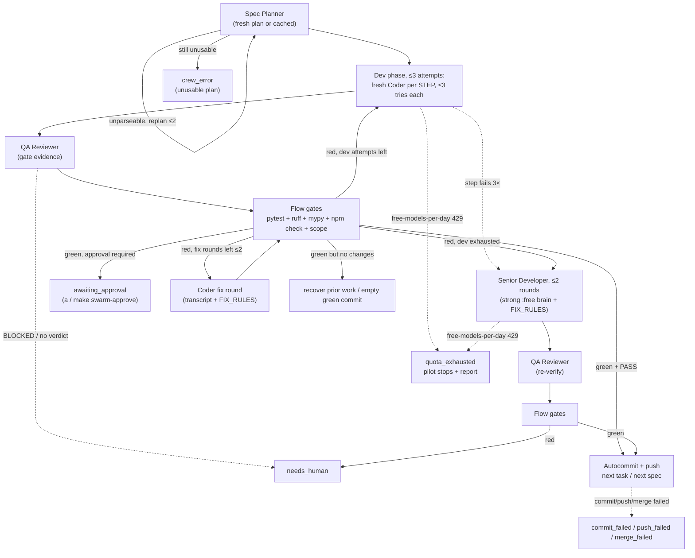

# Swarm harness — usage

Free-first CrewAI swarm that implements `specs/` tasks one at a time (`specs/009-swarm-harness/`, hardened by `specs/012-dark-factory-harness/`).
Roles: Planner + Coder + Reviewer, sequential; green runs autocommit and advance the queue.
Phase 0 of 012 is implemented: run-delta attribution, scope/secret guards, truthful green, plan hashing, commit/push coupling, single-run lock, approval holds, and AC evidence in `run.json`. Phase 1 has started with `make swarm-preflight` (T12).

## Prereqs
- `uv` installed; Python 3.12 available (`uv python list`). System Python 3.14 does NOT work with CrewAI (`>=3.10,<3.14`).
- Ollama serving locally: `ollama serve` + `ollama pull qwen3.5:9b` (default `OLLAMA_BASE_URL=http://localhost:11434`).
- Keys (never commit): root `.env` with `OPENROUTER_API_KEY` (planner/senior `:free` models);
  `OPENCODE_API_KEY` only if you route a role to `zen/*` (Zen's free tier is client-only, so the
  API path is paid — see the model table).

## Setup
```bash
uv venv -p 3.12 swarm/.venv
VIRTUAL_ENV="$PWD/swarm/.venv" uv pip install -p "$PWD/swarm/.venv/bin/python" -e 'swarm/[dev]'
cp .env.example .env   # optional overrides (keys stay empty until you fill them)
swarm/.venv/bin/python -c "from crewai import LLM,Agent,Task,Crew; print('ok')"
```

## Project-agnostic core
The harness does not hardcode a language or framework. Gate commands come from
`SWARM_GATE_COMMANDS` (semicolon/newline separated), scope from `SWARM_SCOPE`, and
the coder prompt is stack-inferred. Point those at another project and the same
flow works; only the guard *implementation* (`swarm/tools_guarded.py` path/secret
rules) is repo-specific.

## Model tiers (`swarm/llms.py` — the only file that picks models)
Verified 2026-11-08 (tool calls + latency): free unless noted.

| Role | Default | Cost |
| --- | --- | --- |
| Coder | `SWARM_CODER_MODEL=ollama/swarm-coder:latest` (Qwen3.5 9B, `make swarm-coder-image`) | $0 local, ~6–13 s |
| Planner | `SWARM_PLANNER_MODEL=openrouter/nvidia/nemotron-3.5-super-vl:free` | $0, 1M ctx, ~1 s |
| Reviewer | `SWARM_REVIEWER_MODEL=ollama/swarm-qa:latest` (Qwen3.5 9B, 64k ctx, QA prompt) | $0 local |
| Verdict fallback | `SWARM_VERDICT_FALLBACK_MODEL=openrouter/nvidia/nemotron-3.5-super-vl:free` (only when local QA gives no verdict) | $0 |
| Senior | `SWARM_SENIOR_MODEL=openrouter/nvidia/nemotron-3-ultra-550b-a55b:free` | $0, 550B, tools OK |
| Zen fallback | `SWARM_ZEN_FALLBACK_MODEL=zen/glm-5.3-flash` (paid, ~$0.006/1k calls) | opt-in, T13 |

All-local variant (no keys, slowest): `make swarm-local` sets every role to Ollama.
On a quota/429 the flow switches every subsequent crew to `SWARM_<ROLE>_FALLBACK_MODEL`
(default local `qwen3.5:9b`; senior prefers cheap Zen when `SWARM_ALLOW_PAID=1`), then retries.

Free/cheap menu (re-checked live with a tool-call probe; ids churn, so run
`make swarm-preflight` before trusting them):
- OpenRouter `:free` tool-capable: `nvidia/nemotron-3.5-super-vl:free`,
  `nvidia/nemotron-3-ultra-550b-a55b:free`, `recursive/flint-v1.0:free`,
  `cohere/north-mini-code:free`, `nvidia/nemotron-3-nano-omni-30b-a3b-reasoning:free`.
  (`google/gemma-4-*:free` was upstream-429; `nvidia/nemotron-3.5-lightning:free` did not
  emit tool calls. The old planner id `nemotron-3-super-120b-a12b:free` is gone.)
- Ollama local: `swarm-coder`/`swarm-qa` (Qwen3.5 9B, 262k ctx), `qwen3.5:9b`,
  `qwen35-agent`, `llama3.2:1b` (tools work but emits malformed args — not a coder).
- Zen: **free models are client-only** (`FreeUsageLimitError` when called with an API key);
  paid models work from the API — `deepseek-v4.1-flash` (~$0.00002/call) and
  `glm-5.3-flash` are the cheapest. `gpt-5.4-nano` and `beam-free` are region-blocked (DE).

Paid models are hard-blocked: any non-`:free`/non-local/non-`-free` id raises `PermissionError`
unless `SWARM_ALLOW_PAID=1` in env. Override ids via env, never in code.

Model prefixes route automatically: `ollama/*` → local Ollama, `zen/*` → OpenCode Zen
(`custom_openai` gateway; `SWARM_ZEN_BASE_URL` must stop at `/v1` — the SDK appends
`/chat/completions`, a full URL gives 404).

## Preflight (before the first LLM call)
```bash
make swarm-preflight                              # roles/models, keys, Ollama pull, cloud lists, venvs, gates
swarm/.venv/bin/python -m swarm.preflight --offline   # skip provider model-list requests
```
`run_crew` runs the same checks automatically and stops with `preflight_failed` if any fail
(`SWARM_SKIP_PREFLIGHT=1` bypasses). This is 012 T12.

## Run
```bash
make swarm-run                 # foreground pilot (no args = resume; or ./swarm/run.sh 001 T1)
make swarm-local               # all-local pilot: Ollama Qwen for every role (overrides cloud .env)
make swarm-dash                 # dashboard attached to the current pilot
make swarm-up                   # pilot in background + dashboard attached
make swarm-up-local             # all-local pilot in background + dashboard attached
make swarm-test                 # harness unit tests (no LLM, no network)
make swarm-preflight            # validate models/keys/Ollama/venvs/gates (no LLM call)
make swarm-approve             # grant approval for the last checkpoint task (or SPEC=001 TASK=T3)
make swarm-approve SPEC=001 TASK=T3  # grant approval for a specific held task
make swarm-coder-image          # build tuned coder image (swarm/ollama/Modelfile → swarm-coder:latest)
```

Coder image: `swarm/ollama/Modelfile` (`FROM qwen3.5:9b`, temp 0, `num_ctx 65536`,
baked SYSTEM discipline). Use it via `SWARM_CODER_MODEL=ollama/swarm-coder:latest`.
Verified 2026-10-10: builds offline from local blobs, native tool calls work
(with the harness's `think:false`). Tune `num_ctx`/SYSTEM in the Modelfile and rebuild.

## Dashboard (Textual)
`make swarm-dash` / `make swarm-up` open the parallel dashboard:

- **Queue** (left): tasks in order, newest outcome per task from run history
  (`✓` green, `✗` needs_human, `⏸` approval, `⛔` quota/budget, `▶` current).
- **Models**: planner/coder/reviewer/senior, `local` for Ollama, `fallback ON`
  once a quota/429 switched the run; in tail mode it shows the models the run used.
- **Budget**: tokens / cost / wall-clock against `SWARM_MAX_*` with percentages.
- **Gates**: exit code per gate (`✓ 0` / `✗ 1`), scope included.
- **Recent runs**: last tasks for this spec with status, tokens, and cost.
- **Panes**: planner/coder/reviewer logs; status line has elapsed, tokens, cost,
  calls, attempts, plan=cached, senior, and approval state.
- **Human log** (`h`): scrollable "why did it stop?" view — status, notes,
  reviewer output, gate transcript (including `npm run check`), changed files,
  and the last events. `H` replays this run's event history into the panes.

Tail mode (`--tail swarm/runs/<id>`) follows `run.json` + `events.jsonl` of another
process and jumps to the newest run automatically. It opens **fresh**: events logged
before you attached are skipped, panes start empty, and each new task clears the
previous task's log.

Keys: `a`=approve (run dir + ledger), `r`=retry (live mode), `h`=human log
(why the run stopped: reviewer output, gate transcript, notes, events), `H`=history
for the current run, `p`/`n`=older/newer run, `t`=back to the newest run, `q`=quit.
History is opt-in, so long runs never flood a newly opened dashboard.

The dashboard is a read-only view; `run.json`/`events.jsonl` stay the contract
(ADR-011). For per-call spans when debugging, an optional OpenInference/OTel export
to a local Phoenix is the recommended add-on — the TUI is not a tracer.

## How the swarm builds its todo list

The queue comes from `specs/*/tasks.md`, sorted by directory name (`001-…`, `004-…`, …):

- `swarm/spec_loader.py` parses **only unchecked tasks** with this shape:
  `- [ ] T1 (AC-1, AC-2): brief text`
  (regex: `^- \[ \] (T\d+)\s*(\([^)]*\))?\s*:\s*(.+)$`). `- [x]` tasks are invisible to the
  parser, and ids must be `T1`, `T2`, … — `T1a` is not recognized.
- Task order in the file is the execution order (`T1` → `T2` → …). After the last task, the
  loop moves to the next spec directory with tasks.
- Skipped automatically: `009-swarm-harness`, `012-dark-factory-harness`, `013-dark-factory-phase-2`, directories without
  `tasks.md`, and specs whose tasks are all `[x]`/have no parseable tasks.
- The planner reads `specs/<dir>/{spec,plan,tasks}.md` plus the constitution. The `brief` it
  receives is the text after the colon on the task line; indented notes below the line are fine
  but do not replace the brief.
- Progress between invocations comes from `swarm/runs/` history (`_resume_point`): latest green
  → next task/spec, red or killed → retry the same task. A checkpoint task that is already `[x]`
  (or was renamed) advances to the next open task; if the rest of the queue is done, resume wraps
  to the earliest open spec so newly added earlier-spec tasks are not stranded.
- `--spec` accepts a unique prefix (`001` → `001-example-app`). If two directories share a prefix,
  pass the full directory name.

## Adding a spec to the swarm todo list

1. Create `specs/NNN-name/` (`NNN` controls queue position) with:
   - `spec.md` — what/why, scope, acceptance criteria using stable ids (`AC-1`, `AC-2`, …).
   - `plan.md` — approach, ordered steps, risks; name the files you expect to change.
   - `tasks.md` — the queue (see format below).
2. Write one unchecked task per line, in order, e.g.:

   ```markdown
   # 012 My Feature — Tasks

   - [ ] T1 (AC-1): Add `POST /thing` in `app/main.py` plus a test in `tests/test_thing.py`.
   - [ ] T2 (AC-2): Render the result in `frontend/src/App.svelte` and keep `npm run check` green.
   - [ ] T3 (AC-3): Show the comfort score in `frontend/src/App.svelte`.
   ```

   Keep `T<n>` and the `(AC-…)` refs on the same line as the brief. The brief must be
   self-contained: one behavior change, exact paths, and what "done" means.
3. Make each task coder-sized: one file/behavior, ~4–8 planner micro-steps, verifiable by the
   project gates in `SWARM_GATE_COMMANDS` (this repo: `pytest -q`, `ruff check .`,
   `mypy app tests`, `npm --prefix frontend run check`, `npm --prefix frontend run lint`).
   Split larger work into more tasks.
4. Respect the coder scope. Default: `app/`, `frontend/`, `tests/`, `contracts/`,
   `requirements*.txt`, `pyproject.toml`, `.gitignore`. Anything else needs an explicit override,
   e.g. adding a `scripts/` prefix:

   ```bash
   SWARM_SCOPE=app/,frontend/,tests/,scripts/ make swarm-up
   ```

   `swarm/`, `specs/`, `docs/`, and `.env*` are off-limits to the coder by design. The override
   **replaces** the defaults, so list every prefix the task needs (e.g. `app/,frontend/,tests/`,
   plus `pyproject.toml` if the task changes it).
5. Start it explicitly the first time (or when the new spec sorts before the current checkpoint):

   ```bash
   make swarm-run SPEC=012 TASK=T1      # foreground, then continues through the queue
   ./swarm/run.sh 012 T1 --single       # only this task
   ./swarm/run.sh 012 T1 --no-commit    # do not autocommit/push
   ```

   With no arguments, `make swarm-up` / `./swarm/run.sh` resumes from run history.
6. The swarm **does not edit spec files**. After a green run is reviewed, change `- [ ]` to
   `- [x]` yourself — that removes it from the queue. Do not check a task before it is green:
   the parser will skip it and an explicit start on that id fails with
   `No task … (have: …)`.
7. If you edit `spec.md`/`plan.md`/`tasks.md` after a plan was cached in
   `swarm/runs/plans/<spec>-<task>.md`, force a fresh plan with `--replan`:

   ```bash
   ./swarm/run.sh 012 T1 --replan
   ```

   Without it the cached `STEP` list is reused even if the spec changed.

Each run still has to pass the flow's own gates and scope check (`pytest`, `ruff`, `mypy`,
`npm --prefix frontend run check` / `run lint` when the frontend is installed, plus an optional frontend test).
`npm test` when the frontend test script exists); green runs autocommit in-scope changes and push
(`swarm: <spec>-<task> green …`) before continuing.

Each run writes:
- `swarm/runs/<ts>-<pid>-<rand>/run.json` — spec, task, status (`green`/`needs_human`/`crew_error`/…), gate exit codes, usage (tokens/cost/timestamps).
- `swarm/runs/<ts>/events.jsonl` — streamed agent events; `usage.json` when available.
Tail mode follows the loop: when a newer run becomes `latest`, the dashboard jumps to it
(task list + plan note re-sync). Plan validation: planner output without `STEP` lines fails
the run instead of executing garbage. A run with no new in-scope changes recovers the same
task's interrupted paths whenever they are still dirty (unrelated dirty files are left
alone); otherwise it records an empty green commit (`Swarm-Vacancy: 1`) and advances. Only unrelated dirty in-scope work still
stops as `needs_human`.

## Agent tools (guarded, `swarm/tools_guarded.py`)
- `Repo Edit` — exact-match replace, exactly-once occurrence required, repo jail, **coder-scope check**, secret-path refusal.
- `Repo Create` — new files only (makes parent dirs, refuses existing/escapes), **coder-scope check**, secret-path refusal. Scaffold needs it: without it the coder cannot create `app/__init__.py` et al.
- `Guarded Shell` — argv-only (`shlex.split` + `shell=False`, never `shell=True`): `pytest`, `ruff check` (including `--fix`), `mypy` (gates); `git status|diff|log` (read-only); `ls`, `cat`, `grep` (read-only inspection, no recursive grep); `npm --prefix frontend run check|build|lint|test`. Rejects shell metacharacters, absolute paths, `..`, `.env*`/key files, `npm install`/`npx`, `pip`/`uv`, and `python -c`. 120s timeout, repo cwd. Coder crews construct it with `allow_gates=False` (QA-only gates); fix crews and the Reviewer get `allow_gates=True`.
- Read-only: trimmed file reads (3000 chars max) with the same secret/path guard; `ls` via Guarded Shell (no directory-search tool).

## Gates (sequence)
Planner splits the task into `STEP n:` micro-steps → one fresh coder per step (fresh
context each, max 8 steps) → Reviewer verifies once at the end → `flow` re-runs
every command from `SWARM_GATE_COMMANDS` (this repo: `pytest -q`, `ruff check .`,
`mypy app tests`, `npm --prefix frontend run check`, `npm --prefix frontend run lint`)
itself (never trusts agent claims). Red gates or a reviewer `BLOCKED` → fix
round: Coder investigates with the QA report (+ Reviewer re-verify), max 2 rounds
(`MAX_FIX_ROUNDS` in `swarm/crew.py`). Still red → `needs_human`, TUI pauses,
`r` starts a fresh run. Crash → one fresh re-kickoff, then `crew_error`.

### Gate ownership (who runs what)

- **QA (Reviewer) is the only agent that runs gates.** It executes
  `SWARM_GATE_COMMANDS`, pastes exit codes + tails, and ends with
  `VERDICT: PASS`/`BLOCKED`.
- **Coders never run gates during development.** Their `Guarded Shell` is built
  with `allow_gates=False` and answers `BLOCKED: gates are QA-only`. A fix round
  starts only after QA `BLOCKED` (or red flow gates); then the coder gets
  `allow_gates=True` plus the QA report and may reproduce/confirm the fix
  (`VERIFY_RULE` in `swarm/crew.py`). This keeps QA the single verification owner
  without spending coder tokens on duplicate gate calls.
- **The flow re-runs the gates itself** on every verification step (truthful green,
  012 AC-4). That is harness code, not an agent turn, so it cannot be skipped or
  faked by a model.

Green is deliberately strict (012 AC-4/AC-6):
1. every gate exits `0` (including the run-delta scope gate);
2. the Reviewer's final word is `PASS` (`BLOCKED` → `needs_human`; a missing verdict gets one free-model repair);
3. a non-empty in-scope run delta, or the same task's recovered interrupted delta, or an
   empty green commit when the tree is already clean/satisfied (never a blind commit of
   unrelated dirty work);
4. approval is present when `SWARM_REQUIRE_APPROVAL=1`/`--require-approval`;
5. commit + push succeed. `commit_failed`/`push_failed`/`merge_failed` are not green.

Plan cache: planner output is saved to `swarm/runs/plans/<spec>-<task>.md` with a
`<!-- plan-source: sha256 -->` header over `spec.md`+`plan.md`+`tasks.md`. A changed spec
invalidates the cache automatically; `--replan` still forces re-planning. Zero-step,
malformed, or over-`MAX_STEPS` plans fail through the normal replan/`crew_error` path —
they are never silently truncated.

## Trust & safety (012 Phase 0)
- **Run delta.** The flow hashes every dirty/untracked path before the first LLM call.
  Gates, vacancy, and autocommit use only paths whose content changed during this run;
  a human's pre-existing dirty work is neither a gate failure nor committed.
- **Single writer.** `swarm/runs/.lock` (`flock`) blocks a second pilot; `swarm/runs/swarm.pid`
  lets `make swarm-stop`/`./swarm/stop.sh` stop the right process. Run dirs use
  `<timestamp>-<pid>-<rand>` so same-second runs cannot collide.
- **Signals.** `SIGTERM`/`SIGINT` write `status=interrupted` to `run.json` and release the lock.
- **Approval holds.** With `--require-approval` (or `SWARM_REQUIRE_APPROVAL=1`), a green run
  becomes `awaiting_approval` and is not committed. Press `a` in the dashboard or run
  `make swarm-approve` (it approves the last checkpoint task; add `SPEC=001 TASK=T3` to
  be explicit). Approval is stored in
  `swarm/runs/approvals/<spec>-<task>.json` (and `approved.json` in the run dir).
- **Role-aware prompts.** `SCOPE_RULE` is generated from `DEFAULT_SCOPE`, and the coder role
  becomes `Frontend Coder`/`Test Coder` when the brief is frontend/TS/npm or test work.

## Autonomous loop (default)
A green run autocommits **only the run-delta in-scope changes** and pushes, then loops
back to the planner for the next task — and after a spec's last task, to the next spec
with tasks (directory order; specs without `tasks.md` and the harness specs `009`/`012`/`013`
are skipped). First non-green task stops the whole loop (`needs_human`/`crew_error`/
`commit_failed`/`push_failed`/`merge_failed`/`awaiting_approval`/`quota_exhausted`/
`budget_exhausted`/`interrupted`/`preflight_failed` in that task's `run.json`).
Flags: `--single` runs only the given task, `--no-commit` skips
autocommit+push (passed through `run.sh` extra args,
e.g. `./swarm/run.sh 001 T1 --single`).

## Commit path: branch-per-task + merge queue (012 T18)
Default (`SWARM_MERGE_MODE=merge`):
1. `git switch -c swarm/<spec>-<task>` (worktree changes travel with it).
2. `git add` only the run-delta in-scope paths; commit `swarm: <spec>-<task> green …`.
3. Push the task branch (`git push -u origin <branch>`).
4. Switch to the base branch (`SWARM_BASE_BRANCH`, default current branch) and
   `git merge --no-ff` with `merge: swarm <spec>-<task> green`.
5. Push the base. If that final push fails, local `reset --hard` back to the pre-merge
   SHA (status `push_failed`, branch kept as the recovery point / `rollback` in `run.json`).

Merge conflicts abort the merge, leave the branch intact, and stop with
`merge_failed` — never a half-merged green. Out-of-scope dirty files are never staged.
`SWARM_MERGE_MODE=direct` restores the old commit-straight-to-base path;
`SWARM_DELETE_MERGED_BRANCH=1` deletes a merged branch locally and remotely.

## Done ledger, approval resume, crash checkpoints (013)
- **Done ledger (commit trailers).** Every green commit carries
  `Swarm-Task: <spec>/<T n>`, `Swarm-Task-Hash` (id+brief+ACs) and
  `Swarm-Spec-Hash` (`spec.md`+`plan.md`). Resume/auto-advance skip a task whose
  hashes still match even when its line is still `- [ ]`; the swarm still never
  edits `specs/`. Editing the brief/ACs *or* `spec.md`/`plan.md` reopens the task.
  Marking `[x]` alone changes neither hash. A gitignored
  `swarm/runs/done.json` cache covers shallow/rewritten history. An explicit
  `./swarm/run.sh SPEC TASK` still runs that task even if done.
- **Approval resume.** An `awaiting_approval` run records `delta_hashes` and the
  current `head`. `make swarm-approve` / `--approve` / TUI `a` commits exactly
  that verified delta through the branch/merge queue, rewrites the run to `green`,
  and the next resume advances — no crew rerun. It refuses (run stays held) if the
  recorded files changed, HEAD no longer descends from the hold, or new in-scope
  edits appeared. Only out-of-scope human edits are ignored. With no held run, the
  command falls back to the next-run approval ledger.
- **Crash checkpoints.** After every micro-step the flow atomically writes
  `progress.json` (plan hash, steps, completed index, per-step outputs, run-delta
  hashes). A killed/interrupted run resumes at the next step only when plan, steps,
  and file hashes still match and the checkpoint is younger than
  `SWARM_RESUME_MAX_AGE_SECONDS` (default 86400). Gates and the reviewer always
  rerun. Otherwise the task restarts from step 1 and `run.json` records
  `recovery="restart"` + `recovery_note`; a checkpoint resume records
  `resumed_from_step` and `recovery="checkpoint"`.

## Container sandbox (012 T17)
```bash
make swarm-sandbox                       # build + run the pilot in Docker
./swarm/sandbox.sh --dry-run 001 T3      # print the mount/run command, touch nothing
```
Needs a Docker daemon. On macOS without Docker Desktop, Colima works:
```bash
brew install colima docker        # already installed here
colima start --cpu 4 --memory 8 --disk 60   # 8 GB keeps the image build happy
docker context use colima         # `colima start` usually selects it already
```
Verified 2026-11-08 with Colima (8 GB): image build, imports, the full 148-test
harness suite inside the container, OpenRouter egress, Ollama via
`host.docker.internal`, and a real coder+planner model call.

The image (`swarm/docker/Dockerfile`) has app + harness deps and the gate binaries.
At runtime the **only mounts are the repo** (`$PWD:/work`, rw) and a read-only
`/dev/null` overlay on `.env`, so the coder process/tools cannot read secrets from
the repo; keys arrive as env values via `--env-file`. No HOME, SSH agent, or host
caches are mounted, with `--cap-drop=ALL`, `no-new-privileges`, PID/memory caps,
and the host UID.

- Ollama: the container reaches the host at `host.docker.internal:11434`
  (override with `SWARM_SANDBOX_OLLAMA_URL`). With Colima this works even when
  Ollama listens on `127.0.0.1`; on plain Linux, bind it with
  `OLLAMA_HOST=0.0.0.0 ollama serve`.
- Commits default to **off** in the sandbox (no git credentials): review and commit
  on the host. Opt in with `SWARM_SANDBOX_ALLOW_COMMIT=1`; for SSH remotes also set
  `SWARM_SANDBOX_SSH=1` to mount `~/.ssh` read-only.
- `SWARM_SANDBOX_NO_BUILD=1` reuses the last image; `SWARM_SANDBOX_IMAGE` renames it.

## Resume from checkpoint
`make swarm-up` / `./swarm/run.sh` with no args resumes where the sequence last stopped:
latest run green → next task (or next spec); red, killed mid-run (`meta.json` only), or
held (`awaiting_approval`) → same task again; everything green → exits with
`all specs complete`. Explicit `SPEC TASK` args always override. Resolution lives in
`_resume_point` (`--resume` flag). To release an approval hold, use
`make swarm-approve SPEC=… TASK=…` (or `./swarm/run.sh SPEC TASK --approve`), then resume.

## Escalation (dev ×3 → senior → QA)
Each task gets up to `DEV_ATTEMPTS` (3) dev phases (micro-steps + review + 2 fix rounds
each, cached plan reused). A single micro-step failing `STEP_ATTEMPTS` (3) times is
rescued by the senior inline, then the phase continues. Still red after all dev phases →
up to `SENIOR_ATTEMPTS` (2) senior passes: `SWARM_SENIOR_MODEL`
(OpenRouter `:free`, must differ from planner; Zen free tier is locked to OpenCode
clients) fixes everything in one go via `build_senior_crew`, then QA re-verifies and
gates re-run. Still red → `needs_human`. Attempts + `senior_used` recorded in `run.json`.

Quota: a daily `free-models-per-day` / 429 error first switches the run to fallback
models (`SWARM_<ROLE>_FALLBACK_MODEL`, default local `qwen3.5:9b`; senior tries
`zen/glm-5.3-flash` when paid is allowed) and retries. If the fallback is also out,
the pilot stops with `quota_exhausted`, a `quota_note` in `run.json`, and a
`QUOTA EXHAUSTED` line in `up.log`. Transient 429/timeout/5xx errors get exponential
backoff (1s→8s, 3 attempts) before giving up.

## Usage, cost & budgets (012 T11/T14)
Every kickoff adds `CrewOutput.token_usage` to the run: prompt/completion/cached
tokens, LLM calls, and the models actually used. `run.json` gains:

```json
"usage": {"prompt_tokens": 8123, "completion_tokens": 640, "total_tokens": 8763,
          "llm_calls": 14, "models": ["ollama/swarm-coder:latest"],
          "cost_usd": 0.0, "started_at": "…", "finished_at": "…", "duration_seconds": 92.4}
```

Local Ollama and `:free` models are exactly `$0`. A paid model with a known rate
(`swarm/usage.py`) is estimated from tokens; an unknown paid rate reports
`cost_usd: null` / `cost=unknown` in the TUI instead of inventing a number.

Budgets are env-driven and stop the pilot with `budget_exhausted`:
`SWARM_MAX_TOKENS` (2M), `SWARM_MAX_COST_USD` ($0.05), `SWARM_MAX_RUNTIME_SECONDS`
(14400, per task). Set any to `0` to disable it. `budget_note` records which limit tripped.

## Event listener & dashboard (012 T15)
Each flow unregisters its CrewAI event handlers on `save_run` (`SwarmListener.teardown`),
so long autonomous loops do not leak handlers or keep writing to old run dirs.
Tail mode reads `events.jsonl` from a byte offset with a partial-line buffer instead
of re-reading the whole file every tick.

## Role sequence


## Unit tests (no LLM, no network)
```bash
swarm/.venv/bin/python -m pytest swarm/tests -v
```

## Traces & logs (all inside the project, never `/tmp`)
- Pilot runs: `swarm/runs/<ts>-<pid>-<rand>/{run.json,events.jsonl,progress.json}` (+ `latest` pointer).
  `run.json` records brief, `ac_refs`, changed files, gates, reviewer verdict, approval,
  commit/push result, usage, done-ledger hashes, checkpoint recovery, and a compact `evidence` block.
- Approvals: `swarm/runs/approvals/<spec>-<task>.json` (task-keyed, survives retries);
  held-run deltas are committed by `make swarm-approve` (013).
- Done ledger: `swarm/runs/done.json` cache (git commit trailers remain the source of truth).
- Coordination: `swarm/runs/.lock` (flock), `swarm/runs/swarm.pid` (stop target).
- Ad-hoc probes/debug: `swarm/runs/probes/<name>-<date>.log`. `swarm/runs/` is gitignored.

## Anti-loop guards (Qwen-9B wanders: re-reads files, blows 262k ctx)
- `TrimmedFileReadTool`: observations capped at 3000 chars (re-read via `start_line`/`line_count`).
- No `DirectoryReadTool`: `ls` via Guarded Shell has fewer wandering branches.
- Task prompts carry hard loop rules (≤6 tool calls, never re-read, answer from observations).
- `max_iter` 10/10/5 + 1 fix round max. Still stuck → `needs_human`.

## Troubleshooting
- `429 free-models-per-min` (OpenRouter): per-minute quota on `:free` (20/min). Wait ~60s and retry; LLMs already set `max_retries=5`. Persistent → change `SWARM_PLANNER_MODEL` to another `:free` id from `curl "https://openrouter.ai/api/v1/models?supported_parameters=tools&sort=pricing-low-to-high"`.
- `Python >=3.10,<3.14 required`: recreate venv with `-p 3.12`.
- Ollama refused: `ollama serve`; check `curl http://localhost:11434/api/tags`.
- `Invalid response from LLM call - None or empty` on local Qwen: thinking blocks break tool parsing — harness already sets `extra_body={"think": False}` on all Ollama LLMs; if you add a new Ollama model id, keep it. Single transient empties still occur; `flow` re-kicks the crew once automatically.
- Local Qwen-9B as **planner** loses the plot (verified 2026-10-10: listed `.git/` internals, asked "what would you like to do" instead of writing the plan). Keep cloud brains (OpenRouter `:free` / Zen) for planner + reviewer; local Qwen is coder-only material with reviewer gates.
- `swarm/.venv/`, `swarm/runs/`, `swarm/.env` are gitignored — safe to run freely.
