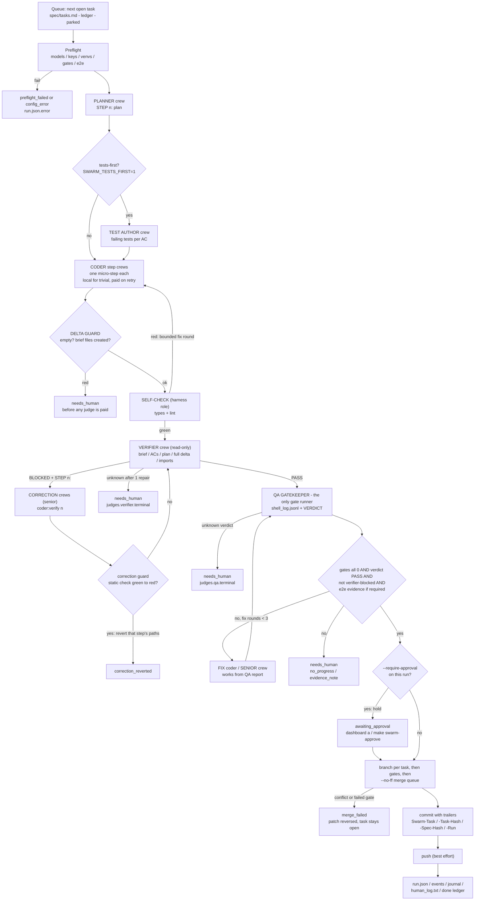

# How the swarm organizes the work

> Part of the swarm harness documentation. Start at [`../README.md`](../README.md).

## How the swarm organizes the work

One task at a time: a `- [ ] T<n>` line from `specs/*/tasks.md` that the done
ledger does not already hold. Each phase is a small CrewAI crew with its own
model role; a CrewAI Flow (`swarm/flow.py`) sequences them and owns every
decision that must not be made by a model (retries, scope, green, commit).

### Roles

| Role | Model env | Job | Can make a run green? |
| --- | --- | --- | --- |
| Planner | `SWARM_PLANNER_MODEL` (paid allowed) | Reads spec + plan, emits `STEP n:` lines | no |
| Test author (optional, `SWARM_TESTS_FIRST`) | coder | Writes failing tests per AC, no implementation | no |
| Coder (step crews) | `SWARM_CODER_MODEL` (local for trivial, paid for real) | One micro-step per crew: read → edit | no |
| Self-check | `harness-selfcheck` (harness role, no model) | Runs static checks (types/lint), hands a red one back as a bounded fix round | no (never QA evidence) |
| Verifier | `SWARM_VERIFIER_MODEL` | Read-only: does the scenario do what the brief says? `VERDICT: PASS/BLOCKED` + `FINDING:`/`STEP n:` | no (advisory, blocks only) |
| Correction crew | senior | Executes the verifier's `STEP n:` plan (role `coder:verify<n>`) | no |
| QA Gatekeeper | `SWARM_REVIEWER_MODEL` | The only agent that runs the gates; records argv/exit/output in `shell_log.jsonl`, then declares `VERDICT: PASS/BLOCKED` | **yes** — green = QA evidence + PASS |
| Fix coder / senior fix | coder / senior | Works from QA's report (`file:line: message`, failing gates first) | no |
| Conflict resolvers | conflict model | Merge conflict, stash conflict | no (gates decide) |

### The sequence

1. **Preflight** — models, keys, venvs, gate binaries, Playwright browsers, the
   crews' real role factories. Fail before the first LLM call.
2. **Plan** — the planner emits `STEP n:` lines (cached, content-hashed,
   vacancy-checked).
3. **Micro-steps** — one coder crew per step; routing picks local vs paid;
   transient failures are retried by the harness (agents have
   `max_retry_limit=0`).
4. **Delta guard** — model-free: empty delta → `no_delta`; a brief-named file
   never created → `delta_incomplete`. Stop before any judge is paid.
5. **Self-check** — static checks; red goes back to the coder as a bounded fix
   round.
6. **Verifier** — read-only scenario check over the brief, the referenced ACs,
   the plan lines, the full delta files and the import graph. `BLOCKED` →
   correction crews → re-verify, bounded. A correction that turns a green static
   check red is reverted (`correction_reverted`).
7. **QA** — runs the gates, judges the work, declares the verdict. The budget
   never blocks it: it decides work already paid for.
8. **Fix loop** — QA→coder→QA, max 3 rounds, then senior escalation. A round
   that changes nothing (`no_progress`) or the same failure signature ends the
   loop.
9. **Green gate** — only when every gate exits 0, the reviewer says `PASS`, the
   verifier is not blocked, e2e evidence exists when the brief names
   `frontend/e2e/*`, and the run was not started with `--require-approval` (the
   one hold that exists). Then: branch per task → gates → `--no-ff` merge queue →
   commit with trailers (`Swarm-Task`, `-Task-Hash`, `-Spec-Hash`, `-Run`) →
   push. Green-but-unconfirmed (a selected subset only) is `needs_human`.
10. **Record** — `run.json`, `events.jsonl`, `shell_log.jsonl`, `progress.json`,
    the journal, `human_log.txt`, the done ledger.

### Flow

### The invariant that shapes everything

- **Green is QA's, not the model's prose.** Gate exit codes come from
  `shell_log.jsonl`; the verifier, self-check and correction crews run under
  their own roles, so their executions can never be counted as QA evidence.
- **Deterministic guards sit around the judges, not inside them.** They stop
  with typed reason codes (`no_delta`, `delta_incomplete`, `correction_reverted`,
  `e2e_missing`, `quota_exhausted`, `wall_budget`, `verifier_blocked`) and none
  of them can make a run green.
- **One retry authority.** The harness retries, falls back and backs off; agents
  retry zero times (`max_retry_limit=0`).
- Several independent tasks can run at once via `make swarm-parallel` (detached
  worktrees, `--no-commit`), but integration is serial with the main tree as the
  single writer.
